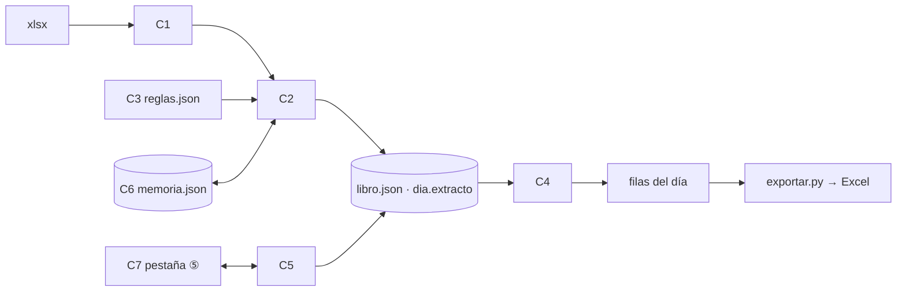

# 03 · Diseño — extracto bancario (01c #5) · M · 2026-10-20

## Summary
- **Las líneas del extracto se guardan dentro del día del libro** (`libro[fecha]["extracto"]`), igual que `banco` y `cierre`. Así importar es una sola escritura atómica de libro.json y el libro sigue siendo "entradas → construir()" (ADR-012).
- **Las casillas «banco» no se reescriben, se derivan.** Una casilla vacía toma la suma del extracto para ese medio. Una casilla digitada se respeta y, si difiere, se muestra la diferencia. Nunca hay dos asientos del mismo recaudo (R4, P1, ADR-012).
- **Reglas en JSON, cero códigos PUC en el código.** `extracto_reglas.json` tiene el prefijo anclado + signo → concepto → destino (casilla, cuenta fija o revisar). Las cuentas van con su fuente y la marca «por_confirmar» (P2, ADR-013).
- **La cuenta de las salidas se recuerda por tercero** en `datos/extracto_memoria.json`. Las descripciones opacas (TRANSFERENCIA CTA SUC VIRTUAL) nunca se recuerdan, siempre van a revisión (ADR-014).
- **Una salida que ya es una factura pagada por banco** se enlaza a la factura (valor exacto, ±3 días, candidato único) y no genera asiento. Queda en revisión para confirmarla (ADR-015).

## 1 · Drivers
- Drivers: R1 (importar sin duplicar), R4 (sin doble conteo), R5 (elegir y recordar la cuenta), R6 (asientos automáticos), R8 (Excel cuadrado). NFR: todo o nada por importación, determinismo, valores regulados en JSON.
- No drivers: R3 (totales, es una consulta), R7 (un aviso más en la regla), R9 (sale gratis de ADR-012). Latencia: el volumen es diminuto.

## 2 · Estimaciones
- 1 usuario, 1 PC. ≈650 líneas al mes, 1–4 importaciones al mes, ≈20 elecciones al mes después del primer mes (la memoria absorbe el resto).
- Almacenamiento: ≈200 B por línea → ≈1,5 MB al año dentro de libro.json (hoy pesa 1,8 MB). Pico = 1 import, sin concurrencia.
- Presupuesto p99. **Importar 1 mes < 3 s:** leer el xlsx (openpyxl read_only) ≈0,8 s + clasificar ≈0,05 s + recalcular ≈30 días ≈0,5 s + escribir libro ≈0,2 s. **Guardar una elección < 300 ms:** leer + recalcular 1 día + escribir ≈150 ms. El salto dominante es la escritura completa del JSON (ver Riesgos, 10×).
- Fuera de capacidad: el archivo tiene un tope de 5 MB y de 5 000 filas. Si lo pasa, se rechaza con un mensaje y no se escribe nada. No hay cola.

## 3 · Componentes
| # | Componente | Qué es suyo |
|---|---|---|
| C1 | `contable/extracto.py` · `leer_xlsx(bytes) -> list[Linea]` | Valida la hoja «Hoja 1» y las 4 columnas (fecha sin hora, valor entero con signo) y calcula `ocurrencia` y `clave`. Si algo falla, lanza `ExtractoInvalido` con el motivo. |
| C2 | `extracto.clasificar(lineas, reglas, memoria, facturas) -> list[Linea]` | Pone el concepto (primera regla que encaje), el destino, la cuenta y su origen (`regla`/`recordada`/`factura`/`puente`), el tercero y los avisos (signo inesperado, SIN CONCEPTO). Es pura. |
| C3 | `extracto_reglas.json` (junto a `normalizacion.json`) | Lista ordenada `{prefijo, signo, concepto, destino}`. Más `cuentas` {clave: {codigo, fuente, por_confirmar}}, `sin_tercero` [prefijos opacos] y `ventana_factura_dias: 3`. |
| C4 | `asientos.construir(..., extracto=None)` (cambio) | (a) `casillas_efectivas(banco, extracto)` alimenta los recaudos que ya existen. (b) bloque nuevo 5) «Extracto»: cada línea de destino cuenta o revisión → 2 filas contra 11200501, grupo «Extracto», `docs=[clave]`. Las de destino casilla o factura no generan filas propias. |
| C5 | app.py · rutas `/api/contable/extracto/*` | Importar, listar las líneas por revisar, asignar la cuenta, deshacer una importación y totales por concepto. Una sola escritura de libro.json por operación (`_guardar_libro`). |
| C6 | `datos/extracto_memoria.json` | `{memoria: {tercero_norm: cuenta}, importaciones: {imp_id: {archivo, sha256, fecha, nuevas, ya_estaban}}}`. Escritura atómica (tmp + replace). |
| C7 | `static/contable.html` · pestaña ⑤ «Extracto» | Subir el archivo, resumen «N nuevas, M ya estaban», lista de revisión (como ④) con selector de cuenta, totales por concepto, diferencias por medio, deshacer. |

## 4 · Datos
- **Linea** (en `libro[fecha]["extracto"]`): `{clave, fecha, descripcion, referencia, valor:int, ocurrencia, concepto, destino:"casilla:qr"|"cuenta"|"revisar"|"factura", cuenta, origen, tercero, factura_id, avisos[], imp}`.
- **clave** = sha1(fecha|descripción normalizada|referencia|valor|ocurrencia)[:16]. `ocurrencia` = n.º de la línea idéntica dentro del archivo, en orden. Un archivo que se cruza con otro trae las mismas ocurrencias para los días completos, y un día cortado a medias solo agrega las ocurrencias nuevas.
- **Dinero** en pesos enteros (`int`), como el resto del libro. **Fecha** = solo el día (se descarta la hora 05:00).
- **Día sin papeles** (24–30 sept.): se crea `{fecha, documentos:[], banco:{}, cierre:{}, extracto:[…]}` y construir() lo maneja con docs vacíos.
- **Casilla efectiva** = digitada si `banco[k]` > 0, si no la suma del extracto para ese medio. `dif[k]` = digitada − extracto (solo se informa, no se usa en ningún asiento).

## 5 · Interfaces (HTTP, JSON)
- `POST /api/contable/extracto` (multipart `archivo`) → `{imp, nuevas, ya_estaban, dias:[…], por_revisar}` · 400 `{error}` si el archivo no sirve (no se escribe nada).
- `GET /api/contable/extracto/revision?desde&hasta` → las líneas con `destino in (revisar, factura)` o `origen == puente` o algún aviso.
- `POST /api/contable/extracto/<fecha>/<clave>` `{cuenta | factura_id | "ninguna", recordar:bool}` → recalcula ese día y responde con el día.
- `DELETE /api/contable/extracto/importacion/<imp>` → quita las líneas `imp` de todos los días y recalcula (R9).
- `GET /api/contable/extracto/totales?mes=aaaa-mm` → `{concepto: suma}`, `total`, `dif_por_medio` (R3, R4).

## 6 · Cuellos de botella y fallas
- **Lo primero que se rompe:** la escritura completa de libro.json crece con los años (≈+1,5 MB al año). Hoy está bien. Revisar si pasa de 10 MB.
- **El xlsx no abre, es un ZIP con clave o es un formato raro:** sale un 400 con el motivo y el libro queda intacto (todo se valida antes de escribir).
- **Se cae el PC a mitad de la importación:** gracias a tmp + replace queda el libro de antes o el nuevo, nunca uno a medias. memoria.json se escribe *después* del libro. Si se pierde, solo se pierde el nombre de la importación o una elección recordada, no asientos.
- **Las reglas JSON están mal (prefijo roto):** se validan al cargar (`ReglasInvalidas`) y la importación se niega antes de leer el archivo.

## 7 · Amenazas (light: exposed no, 127.0.0.1)
Frontera: archivo del usuario → app. Frontera: datos de terceros → Excel.
- S: no aplica (un usuario, solo local). T: se valida el xlsx y no se ejecuta nada de él (openpyxl `read_only`, `data_only`) (S1).
- R: cada fila guarda `docs=[clave]` + `imp`, para saber de qué línea salió cada asiento (S2). I: los datos quedan en `datos/` y nada sale del PC (S3).
- D: tope de 5 MB y 5 000 filas, y lectura en streaming (contra una zip bomb) (S4). E: las descripciones del banco pueden empezar con `=`/`+`/`-`. `exportar.py:25` ya las escribe como texto: mantener ese test (S5).
- La autorización no aplica. La validación vive en C1 y C2, no en el formulario.

## 8 · Valores externos (regulated)
Todos van en `extracto_reglas.json → cuentas` con `fuente` y `por_confirmar: true` hasta que el contador los firme:
gmf 53152001 (ET art. 871, Ley 1111/2006; manual) · rendimientos 42100505 (manual) · por_cobrar_rappi 13452501 (v1.4.0) · banco 11200501 · puente 51959501 (contable.json) · sugeridas 5105/5120/5135 (manual).
La app no calcula la tasa 4x1000, el 50 % deducible (ET art. 115), las retenciones ni la comisión 530515 (Won't). Solo registra el valor del extracto.

## 9 · Mapa requisito → componente
| Req | Dueño |
|---|---|
| R1 | C1 (formato, clave) + C5 (dedupe por clave, todo o nada) |
| R2 | C2 + C3; fitness test contra la hoja MOVIMIENTOS (≥98 %) |
| R3 | C5 `totales` + C7 |
| R4 | C4 `casillas_efectivas` + ADR-012; salidas ↔ facturas ADR-015 |
| R5 | C2 (memoria) + C6 + C5 asignar + C7 lista |
| R6 | C3 destinos fijos + C4 bloque 5 |
| R7 | C2 (aviso de signo) |
| R8 | C4 (grupo «Extracto») + exportar.py sin cambios de forma |
| R9 | C5 DELETE (filtra por `imp`, recalcula) |
| S1–S5 | C1 (S1, S4), C4 (S2), C5 (S3), exportar.py (S5) |

## 10 · Riesgos
1. **Las reglas no llegan al 98 % de MOVIMIENTOS** por los errores de la hoja. Mitigación: el test reporta cada desacuerdo y una lista de excepciones conocidas aceptadas por el usuario. Es la tarea 1 del plan (un spike de 1 h).
2. **Doble conteo de las salidas ya digitadas como factura.** Mitigación: ADR-015, que enlaza solo con un candidato único de valor exacto y siempre pide confirmar. El caso de 2 o más candidatos va a revisión sin asiento propio.
3. **Una casilla digitada que no cuadra se queda así sin que nadie lo note.** Mitigación: la diferencia por medio sale en ⑤ y en los avisos del día. Hay un botón «usar extracto» que borra el valor digitado.
- **Sacrificado:** conciliación automática y cuentas definitivas (quedan «por confirmar»). La comisión de tarjeta y los otros bancos quedan fuera.
- **A 10×** (varios años o varias cuentas): pasar el libro a SQLite (ADR-001 ya lo usa para el soporte), con una fila por día y por línea, para no reescribir todo el JSON en cada elección.
