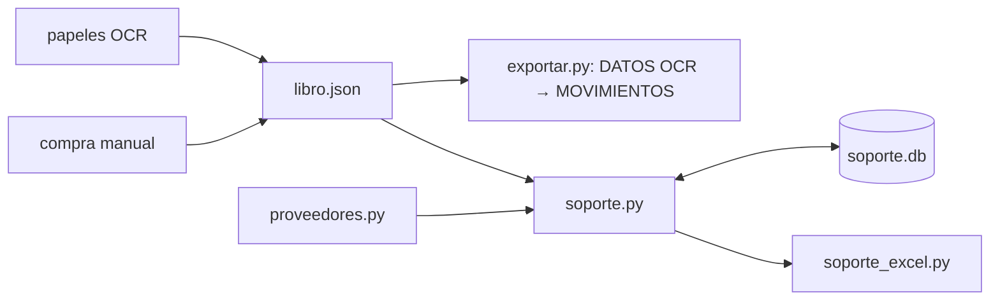

# 03 · Diseño — documento soporte (APROBADO, 2026-10-16)

## Summary
- Dos fases sobre la app Flask local. **Fase A** (R10, R9): nada se descarta en silencio, porque lo que no se lee va a cuentas puente con aviso, y el Excel del libro trae «DATOS OCR», de donde MOVIMIENTOS sale con fórmulas. **Fase B** (R1–R8): proveedores, acumulado proveedor-semana, numeración y Excel para transcribir.
- Datos: `libro.json` sigue igual (fuente de las compras). Lo nuevo y regulado (proveedores, documentos, consecutivos) va a SQLite `datos/soporte.db`, con UNIQUE(prefijo, numero) y transacciones (ADR-001).
- Numeración: el número se reserva en la misma transacción que crea el documento; nunca se libera, solo se anula (ADR-003).
- **Hallazgo legal (cambia R6):** el art. 10 de la Res. 167/2021 dice «a más tardar el último día hábil de la semana» en que ocurrieron las operaciones, no la semana siguiente que decía 01. La regla de plazo queda configurable y por defecto se usa la estricta, hasta que contabilidad confirme (Riesgo 1).

## 1 · Qué guía la arquitectura
- Drivers: N1 (número único y nunca reutilizado), R3 (agrupar proveedor-semana), R7 (lo transmitido no cambia), R9 (fórmulas, no macros), R10 (sin descartes silenciosos), N2 (trazabilidad hasta el papel).
- No son drivers: N4 (volumen ínfimo) y N3 (ya es local).

## 2 · Estimaciones
- 1 usuario y 1 proceso. Unos 1.500 papeles al mes, unas 300 compras al mes y ≤50 documentos al mes. `soporte.db` crece menos de 1 MB al año.
- Presupuesto p99: generar la semana ≤2 s; Excel soporte ≤2 s; Excel libro de un mes con fórmulas ≤5 s. El costo dominante es openpyxl escribiendo celdas: escribir en una pasada y no releer.
- Sobre capacidad: no aplica. Un solo usuario; `LOCK` serializa las escrituras.

## 3 · Componentes (backend primero)
1. **`contable/asientos.py` (cambia, Fase A)**: en vez de saltar, manda a puente: una venta sin medio → débito `puente_ingreso`; una factura sin valor → línea en la lista de pendientes con valor 0 y aviso (no inventa un valor). Un gasto sin cuenta → `puente_gasto`. Toda fila exportable tiene código.
2. **`contable/exportar.py` (cambia, Fase A)**: `libro_a_excel` escribe primero «DATOS OCR» (una fila por papel) y después MOVIMIENTOS, donde cada importe es una fórmula hacia DATOS OCR (ADR-002). Se mantienen las columnas de 01b.
3. **`contable/soporte_db.py` (nuevo)**: el único módulo que abre `soporte.db`. Esquema, migraciones por `user_version` y transacciones.
4. **`contable/proveedores.py` (nuevo)**: el registro, los alias y el rechazo de encabezados del OCR (R1, R2).
5. **`contable/soporte.py` (nuevo)**: el núcleo. Junta las compras de `libro.json` con las manuales, agrupa por proveedor y semana ISO, calcula estado y plazo, numera, anula, marca transmitido y prepara notas de ajuste. **Toda validación regulada vive aquí**, no en el formulario.
6. **`contable/soporte_excel.py` (nuevo)**: una hoja por documento más la hoja RESUMEN (R5).
7. **`app.py` (rutas)**: endpoints delgados `/api/soporte/*`. Revisan Origin en POST (amenaza T1) y usan `LOCK`.
8. **`static/contable.html`**: pestaña nueva «Documento soporte» (proveedores, semanas, generar, descargar, transmitido). Es solo vista.

## 4 · Datos (`soporte.db`; dinero en pesos enteros, fechas ISO, hora UTC)
- `proveedor(id, tipo_id, num_id UNIQUE, nombre, direccion, municipio, correo, no_obligado, creado)`
- `alias(texto_norm PK, proveedor_id)`: el texto OCR normalizado se asigna al proveedor.
- `rango(id, clase{DS,NA}, prefijo, desde, hasta, ultimo, activo)`: CTG 1–10000 para DS; NA con su propio rango configurable (Q3).
- `documento(id, clase, prefijo, numero, proveedor_id, semana_iso, fecha_generacion, total, iva, estado{generado,transmitido,anulado}, cuds, ajusta_a, creado)`, con UNIQUE(prefijo, numero).
- `linea(documento_id, fecha_compra, origen_fecha, origen_doc_id, descripcion, valor)`: una copia fija del valor, con referencia al papel (N2).
- Compra manual (R4): se guarda en `libro.json` como documento `tipo=factura, origen="manual"`, para que también salga en DATOS OCR y en el libro. Hay una sola fuente de compras.
- `contable.json` gana: `puente_ingreso`, `puente_gasto`, `regla_plazo` (`misma_semana` | `semana_siguiente`), `aviso_dias`. Los defaults se documentan en la sección 6.

## 5 · Interfaces (firmas)
- `proveedores.resolver(texto) -> Proveedor | None`, `proveedores.es_encabezado(texto) -> bool`, `proveedores.guardar(datos) -> Proveedor` (valida tipo y número de ID).
- `soporte.semanas(desde, hasta) -> [Grupo(proveedor, semana, compras, total, estado, fecha_limite)]`
- `soporte.generar(grupos, confirmar_vencidos=False) -> [Documento]`: transacción `BEGIN IMMEDIATE`; si una compra ya está en otro documento no anulado, rechaza.
- `soporte.marcar_transmitido(doc_id, cuds=None)`, `soporte.anular(doc_id, motivo)`, `soporte.nota_ajuste(doc_id, lineas) -> Documento`
- `soporte.bloqueos(fecha, docs) -> [aviso]`: lo llama el guardado del libro; impide cambiar el valor o el tercero de una compra que está en un documento transmitido (R7).
- `soporte_excel.libro(docs) -> bytes`; `exportar.libro_a_excel(dias, nit) -> bytes` (con DATOS OCR).
- HTTP: `GET /api/soporte/semanas`, `POST /api/soporte/generar`, `POST /api/soporte/<id>/transmitido|anular|ajuste`, `GET /api/soporte/excel`, `GET|POST /api/proveedores`.

## 6 · Valores externos (config con default y autoridad)
| Clave | Default | Autoridad |
|---|---|---|
| `rango.DS` | CTG 1–10000 | Autorización de numeración DIAN del negocio |
| `rango.NA` | prefijo y rango por confirmar | Res. 167/2021 art. 5 (consecutivo interno propio) |
| `regla_plazo` | `misma_semana`: último día hábil de la semana ISO | Res. 167/2021 art. 10 par.; DUR 1625 art. 1.6.1.4.12; Res. 227/2025 (compilación, sin verificar) |
| `aviso_dias` | 2 días hábiles antes del límite | Interno |
| Campos obligatorios | título, fecha = generación, vendedor y NIT, adquirente y NIT, consecutivo, descripción, total con IVA discriminado | Res. 167/2021 art. 4 (firma, formato y CUDS los pone la DIAN) |
| Días hábiles | lun–vie menos festivos de Colombia (lista anual en config) | Ley 51/1983 |

## 7 · Modelo de amenazas (light; `exposed: no`)
- Fronteras: navegador ↔ Flask 127.0.0.1; Flask ↔ disco (`datos/`).
- S: otra página web puede hacer POST a localhost (CSRF) y gastar números → T1: revisar `Origin`/`Host` = 127.0.0.1:5050 en todo POST.
- T: alguien edita a mano `soporte.db` o `libro.json` → `linea` guarda una copia fija del valor y el Excel sale de esa copia; `bloqueos()` detecta diferencias.
- R: el estado y la fecha de cada documento quedan en `documento`; no se borran filas.
- I: hay cédulas en local; `datos/` (incluido `soporte.db`) ya está en `.gitignore` (verificado).
- D, E: no aplican (un usuario y sin login). La autorización es implícita: quien usa el equipo.

## 8 · Mapa requisito → componente
R1, R2 → proveedores.py · R3 → soporte.py + soporte_db.py · R4 → app.py + libro.json · R5 → soporte_excel.py · R6 → soporte.py (regla_plazo) · R7 → soporte.py `bloqueos` + guardado del libro · R8 → soporte.py `nota_ajuste` · R9 → exportar.py · R10 → asientos.py · N1 → soporte_db.py (UNIQUE + transacción) · N2 → `linea.origen_*` · N5 → `probar_documento_soporte.py` y `probar_datos_ocr.py`. Ningún Must queda sin responsable.

## 9 · Riesgos principales
1. **Plazo ambiguo** (misma semana o semana siguiente). Mitigación: `regla_plazo` configurable, con la estricta por defecto; confirmar con contabilidad antes de la Fase B.
2. **Fórmulas de MOVIMIENTOS**: los asientos agregados (caja, cruces) son difíciles de expresar como fórmula. Spike XS: exportar un día real con fórmulas y comparar con el Excel actual, abriéndolo en Excel. Resultado → ADR-002.
3. **Campos del formulario DIAN gratuito sin verificar** (no se pudo abrir la guía PDF). Mitigación: las columnas del Excel siguen el art. 4; ajustar el orden con una captura del formulario que dé contabilidad.

ADRs: `adr/001-sqlite-para-soporte.md`, `adr/002-excel-formulas-desde-datos-ocr.md`, `adr/003-numeracion-reservada.md`, `adr/004-archivo-crudo-ocr.md`.

## 10 · Iteración 4: lectura OCR separada (D1, APROBADO 2026-10-17)
- **Dos PCs, un solo dueño de cada cosa.** El PC de lectura tiene Ollama y fotos, y produce el archivo crudo. El PC del contador importa, arma el libro, la config (`contable.json`) y es el **único** con `soporte.db`, porque dos bases numerarían CTG dos veces (ADR-003). El PC de lectura no genera DS (lo dice LEEME, T21).
- **Archivo** (ADR-004): `.json` `{formato, version: 1, exportado, desde, hasta, sha256, dias:[{fecha, documentos, banco, cierre, guardado}]}`. La `sha256` se calcula sobre `dias` serializado con claves ordenadas. No lleva fotos, solo la ruta en `origen`.
- **Exportar** (T18): `exportar.crudo(lib, desde, hasta) -> bytes` y `GET /api/contable/crudo?desde&hasta` → descarga. Lleva solo días confirmados.
- **Importar** (T19): `exportar.leer_crudo(bytes) -> (dias, errores)` valida, en este orden: tamaño ≤ 40 MB (ya es el tope de la app), JSON, `formato`, `version` y `sha256` (si algo falla, se rechaza el archivo entero sin escribir nada). Después valida por día: fecha ISO, `documentos` es una lista de objetos con `tipo` conocido, valores enteros entre 0 y 10^10, textos ≤ 5.000 caracteres y ≤ 2.000 documentos por día.
  `POST /api/contable/crudo` (multipart) responde con un informe `{nuevos, iguales, conflictos, bloqueados, invalidos}`. Solo aplica `nuevos` y los `reemplazar=[fechas]` que el usuario marque. Cada día pasa por `construir_asientos` con la config local y se guarda con la misma forma de `cont_confirmar`, todo dentro de `LOCK` y en una sola escritura de `libro.json`.
- **Modo sin OCR** (T20): si `/api/estado` dice `ollama=false`, la pestaña de lectura muestra «Importar datos» en vez de «Leer» y el resto de la app funciona igual.
- **Amenazas:** el archivo viene de otro equipo y es input no confiable. Por eso tiene tope de tamaño, los tipos y largos se validan, va `json.loads` (nunca pickle ni eval) y el texto que llega al Excel ya pasa por el escape de FIX-12. Una `sha256` distinta indica que el archivo se cortó o se editó, no que alguien ataque.
- **Riesgo:** si el contador también lee papeles en su PC, un día puede tener dos versiones. El conflicto queda a la vista y nunca se fusiona.
