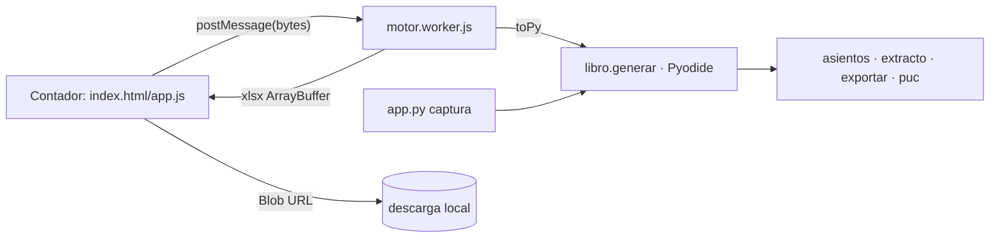

# 03 · Design — modo contador web (Pyodide, todo local)

## Summary
- **Forma:** sitio 100 % estático en Netlify. El navegador del contador corre el núcleo Python tal cual (Pyodide 314.0.7 en un Web Worker); no hay backend, BD ni login. Nada sale del PC: `connect-src 'self'` y solo GET de archivos del propio sitio.
- **Un solo cálculo (ADR-026):** el pegamento de `app.py` que hoy arma el libro con el extracto y el Excel pasa a `parser_module/contable/libro.py`; la app y la página llaman a las mismas funciones. Nada contable nuevo.
- **URL por versión (ADR-027):** subcarpeta inmutable `/vX.Y.Z/` en un solo sitio; Pyodide y wheels en carpetas compartidas por versión de dependencia. Se publica desde el PC del usuario con la CLI de Netlify, solo si pasan los tests.
- **Paquete cerrado (ADR-028):** lista blanca de archivos del núcleo, dependencias con sha256 del lock, CSP estricta; el build falla si entra algo prohibido (`terceros_cuentas.json`, `datos/`, URLs remotas).
- **Top 3 riesgos:** CSP/Worker en Chrome real (spike T1) · límites/MIME de Netlify (deploy borrador primero) · que la página y la app diverjan (test de equivalencia CPython ↔ Pyodide).

## 1 · Drivers (Clarify)
- Drivers: R1 Excel idéntico, R2 extracto como en la app, R3 cero salidas, R5 crudo v1 siempre legible, R6 URL fija, NFR latencia (1ª carga ≤ 30 s, generar ≤ 10 s, sin congelar), S1–S5.
- No drivers: R4 (campos + localStorage), R7 (mensajes), R8 (un archivo más), R9 (Could, fuera de este corte), Firefox/Safari.

## 2 · Estimates
- Usuarios: 1 contador (quizá 2–3 después); ~1–4 usos/mes → carga nula; Netlify gratis (100 GB/mes) sobra (~15 MB por 1ª visita).
- Almacenamiento: ~0,5 MB por versión de página + ~14,5 MB por versión de Pyodide (compartida); en git solo lo pequeño.
- Costo dominante = bytes de la 1ª carga (14 MB). Diseño alrededor: caché `immutable` de 1 año por ruta versionada.
- **Presupuesto p99 (PC del contador, 10 Mbps):** 1ª carga ≤ 30 s = descarga 15 MB ≈ 12 s + init Pyodide ≈ 2 s + wheels/núcleo ≈ 1 s → 50 % de margen. Siguientes ≤ 5 s (caché). Generar un mes ≤ 10 s = leer crudo 0,3 s + extracto 0,5 s + construir+openpyxl ≈ 3 s (2,1 s medido en Node) → ~35 % del presupuesto.
- Sobre capacidad: topes antes de leer (crudo ≤ 20 MB, extracto ≤ 5 MB, memoria ≤ 1 MB), una generación a la vez (botón bloqueado), si el Worker muere → mensaje «recargue la página»; nada se encola.

## 3 · Components (backend arriba; aquí el «backend» es el núcleo)
1. **`parser_module/contable/libro.py`** (nuevo, compartido): dueño del flujo crudo → libro → extracto → Excel. Lo usan `app.py` y el Worker. Valida negocio/NIT y topes aquí, no en el formulario.
2. **`app.py`** (cambio chico): `cont_extracto`, `_recalcular_dia`, `cont_ext_deshacer` y `cont_excel` llaman a `libro.py`; mismas respuestas, mismos tests.
3. **`web/src/motor.worker.js`** (Worker módulo): carga Pyodide de `/pyodide/314.0.7/`, desempaqueta wheels y `nucleo.zip` de su carpeta, llama a `libro.generar` con código fijo (los datos entran como objetos, nunca interpolados en `runPython`), manda avance y el .xlsx como `ArrayBuffer` transferible.
4. **`web/src/index.html` + `app.js` + `estilos.css`**: vista delgada: 3 selectores (crudo, extracto, memoria), negocio/NIT (localStorage con try/catch), «Generar Excel», avance, errores, descarga por Blob URL; muestra versión de página y núcleo; `textContent`, nunca `innerHTML`; @media teléfono/tableta por ancho y alto.
5. **`herramientas/web_build.py`**: arma `web/publicadas/vX.Y.Z/` (núcleo por lista blanca + src con la versión), baja Pyodide/wheels a `web/cache/` y verifica sha256 de `web/web.lock`, ensambla `web/dist/` (todas las publicadas + dependencias + índice raíz + `_headers`), corre los chequeos de ADR-027/028.
6. **`herramientas/web_deploy.py`**: corre `probar_libro.py`, `probar_web.py` y el test de contrato; luego `netlify deploy --dir web/dist` (borrador) → el usuario mira → `--prod`. Token por `netlify login`/variable de entorno, nunca en el repo.
7. **Tests:** `probar_libro.py` (CPython: `generar` = camino de la app), `probar_web.py` (fitness de ADR-026/027/028, cabeceras, lista blanca), `web/pruebas/contrato.mjs` (Node + Pyodide: crudo v1 de prueba → Excel = CPython, en cada versión publicada).

## 4 · Data
- Sin BD ni servidor. En memoria del Worker: crudo (días), líneas del extracto, `memoria` (dict), `lib` (fecha → día), `cfg` = `{negocio, nit, puente_ingreso, puente_gasto}` (puentes = `asientos.CFG`, como `_cont_cfg` sin `contable.json`).
- Persistente: solo `localStorage["ingresos.contador"] = {negocio, nit}`. Si falla, la página funciona y los pide.
- Determinismo: `generar` recibe `ahora` (ids `imp` y `guardado`); los tests fijan el mismo valor en CPython y Pyodide. El Excel no imprime `imp`.
- Fijo por versión dentro de `nucleo.zip`: `puc_cuentas.json`, `plan_de_cuentas.json`, `normalizacion.json`, `extracto_reglas.json`, `por_confirmar.json` (versionados, sin personas). Fuera: `terceros_cuentas*.json`, `modelo_manual.json` (solo el motor de clasificación los usa), `datos/`.

## 5 · Interfaces
- `libro.desde_crudo(dias: list) -> dict` — como importar en un PC vacío.
- `libro.aplicar_extracto(lib, lineas, reglas, memoria, cfg, imp, ahora) -> (lib, resumen{nuevas, ya_estaban, por_revisar, dias_creados})` — hoy dentro de `cont_extracto`.
- `libro.excel(lib, cfg, desde="", hasta="", avisos=()) -> bytes` — hoy dentro de `cont_excel`.
- `libro.generar(crudo: bytes, extracto: bytes|None, memoria: bytes|None, negocio: str, nit: str, ahora: str) -> {xlsx, nombre, invalidos, extracto}`; errores = `EntradaInvalida(mensaje_es)` (envuelve `CrudoInvalido`, `ExtractoInvalido`, memoria/NIT malos).
- Worker: entra `{tipo:"generar", crudo, extracto?, memoria?, negocio, nit}`; sale `{tipo:"avance", paso}` | `{tipo:"listo", xlsx, nombre, invalidos, extracto}` | `{tipo:"error", mensaje, detalle}` (detalle plegado, sin rutas).

## 6 · Threat model (exposed: yes)
Fronteras: **B1** internet/Netlify → navegador (código del sitio) · **B2** archivo subido → Worker · **B3** build ↔ npm/PyPI · **B4** localStorage.
- **S** suplantar el sitio: solo HTTPS en `*.netlify.app` (HSTS de Netlify); el contador recibe el enlace por el usuario. Cuenta Netlify con 2FA (S4).
- **T** cambiar el código publicado (B1): carpetas `/vX.Y.Z/` inmutables + `web/publicadas.lock` en git (ADR-027); deploy solo desde el PC del usuario; dependencias con sha256 (B3, S5).
- **R** repudio: N/A (sin cuentas ni acciones de servidor); la página y el Excel muestran la versión con que se calculó (R6).
- **I** fuga de datos: `connect-src 'self'`, sin analítica/snippets/cookies/formularios (`form-action 'none'`), sin fetch a URLs del usuario (S3, R3); el bundle no lleva datos reales (S1).
- **D** archivo gigante o anidado (B2): topes antes de leer en JS y en `libro.generar`, `RecursionError` atrapado, una generación a la vez (S2).
- **E** ejecutar lo subido (B2): solo `json.loads` y openpyxl en modo datos; `runPython` con texto fijo; `textContent` en la UI; CSP sin `unsafe-inline`/`unsafe-eval` (S2, S4).
- B4: guarda solo negocio/NIT (dato del negocio, no secreto). Autorización: no hay nada que autorizar (S6); la regla de seguridad vive en `libro.generar` (validación) y en las cabeceras.

## 7 · Externally owned values (regulated)
- Ninguno nuevo. Catálogo PUC (Decreto 2650/1993) en `puc_cuentas.json`; GMF 4×1000 (art. 871 ET) y reglas en `extracto_reglas.json`; alias y decisiones de ADR-022 en `por_confirmar.json`; puentes en `asientos.CFG`. Viajan dentro de `nucleo.zip` de cada versión; cambian solo con un tag nuevo. La validación sigue en el núcleo (`puc.py`, `leer_crudo`, `leer_xlsx`).

## 8 · R/S → component
| Req | Dueño |
|---|---|
| R1, R5 | `libro.generar` + `contrato.mjs` + `web_deploy.py` (no publica si falla) |
| R2, R8 | `libro.aplicar_extracto` (compartido con la app, ADR-026) |
| R3, S3, S4 | `_headers` (CSP) + Worker (solo rutas propias) + `probar_web.py` |
| R4 | `app.js` (localStorage) + validación en `libro.generar` |
| R6 | `web_build.py` (`/vX.Y.Z/`, ADR-027) + versión en página y Excel |
| R7 | Worker (mensajes de avance) + `invalidos` de `leer_crudo` |
| S1, S5 | `web_build.py` (lista blanca, lock sha256, ADR-028) |
| S2 | `app.js` (tope previo) + `libro.generar` (topes, errores en español) |
| S6 | N/A: no hay backend |

## 9 · Risks
1. **CSP/Worker/Pyodide en Chrome real** (puede pedir `unsafe-eval` o MIME de `.mjs`/`.wasm`): spike T1 (≤ 1 h) con la página mínima servida en 127.0.0.1 con las mismas cabeceras, en Chrome y Edge. Si pide más, se abre solo en la ruta del Worker y se anota en ADR-028.
2. **Netlify** (tamaño por archivo ~10 MB del wasm, MIME, compresión): primer deploy como borrador y medir la 1ª carga; plan B Cloudflare Pages (25 MiB/archivo) con el mismo `dist/`.
3. **Divergencia app ↔ página:** ADR-026 (un solo `libro.py`) + `probar_libro.py` (CPython) + `contrato.mjs` (Pyodide) comparan celda por celda con el camino de la app.
- **Sacrificado:** corregir cuentas en la página, Vendty, varios crudos (R9), alertas «cambió», modo sin conexión (service worker), Safari/móvil.
- **A 10×:** sigue estático; solo crece el ancho de banda (despreciable). Lo primero que cambiaría: service worker para 1ª carga sin red y varios crudos.
