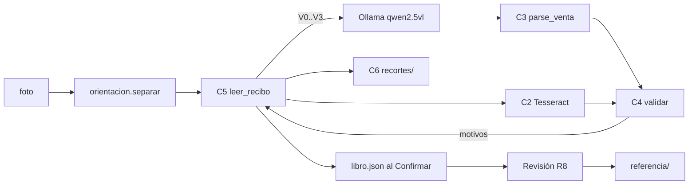

# 03 · Diseño — Precisión del OCR

## Summary
- Cada recorte de comanda pasa por un **bucle leer → validar → releer** en el servidor (`_leer_hoja`), no en el navegador. Lo que valida a la primera se lee una sola vez (ADR-005).
- Una función pura `validar(doc, ctx) → motivos` concentra R1, R3, R5 y R6. El parser de ventas se amplía para sacar ítems, subtotal, pagado, cambio y hora, que hoy no guarda.
- El recibo gana tres campos: `estado` (validado | dudoso | revisado), `motivos` y `lectura` (pasadas, candidatos por campo con variante y motor, nitidez, segundos). `revisado` nunca se sobrescribe.
- Los recortes se guardan en disco por huella (`datos/recortes/<sha>.jpg`), no dentro del libro ni del .json crudo (ADR-006).
- Conjunto de referencia = foto fija en `datos/referencia/` + script `medir_precision.py`, que nunca escribe el libro (ADR-007).
- Sin dependencias nuevas: Laplaciano con numpy; contraste con Pillow (sin OpenCV); Tesseract ya está.

## 1 · Drivers
- Drivers: R1, R2, R5, R7, R8, R9 (Musts); N1 local, N2 ≤3× tiempo, N3 precisión, N4 reproducible, N5 recortes borrables.
- No drivers (caben en el diseño sin cambiarlo): R3 y R4 (señales extra para R2), R6 catálogo, R10 exportar la referencia.

## 2 · Estimaciones
- Volumen: ~600 comandas/mes ≈ 20/día, en 5–8 fotos/día; 1 usuario, 1 PC. Sin carga concurrente.
- Tiempo: hoy T por recorte. Con ≈40 % dudosos × ≤3 relecturas → 1 + 0,4 × 3 ≈ 2,2 T de media (dentro de N2 = 3 T). Peor caso de un recorte: 4 T.
- Recortes: gris JPEG q85 ≈ 60 kB × 600/mes ≈ 36 MB/mes ≈ 430 MB/año. Borrables por rango de fechas.
- Presupuesto de latencia por foto: OCR ≈ 95 % (Ollama), validar + Tesseract + nitidez < 1 s por recorte. La atención va a no releer de más.
- Sobre capacidad: Ollama atiende uno a la vez (un `Lock` alrededor del motor; hoy el navegador ya manda una foto por vez). Tope duro por foto = 3 T medido; al pasarlo se deja de releer y los pendientes quedan «dudoso: tiempo agotado» (degradar, nunca encolar sin límite).

## 3 · Componentes
| # | Componente (archivo) | Qué hace |
|---|---|---|
| C1 | `ocr_module/preprocess.py` · `variantes(img)` y `nitidez(img)` | V0 = `prepare_tiles` actual; V1 = ampliar 1,5× (letra ≥20 px); V2 = gris + `autocontrast(cutoff=1)`; V3 = recorte con 3 % menos de margen. `nitidez` = varianza del Laplaciano (numpy) y Tenengrad. |
| C2 | `ocr_module/digitos.py` · `numeros_tesseract(img)` | Tesseract con lista blanca de dígitos y `.,$`; devuelve el conjunto de números que ve. Si Tesseract no está, devuelve `None` y R3 se salta con aviso. |
| C3 | `parser_module/contable/documentos.py` · `parse_venta` ampliado | Además de lo de hoy: `items[{cant, nombre, valor}]`, `subtotal`, `pagado`, `cambio`, `hora`. |
| C4 | `parser_module/contable/validar.py` · `validar(doc, ctx)` | Puro, sin E/S. R1 aritmética (tolerancia de config, 0 por defecto) y campos que faltan; R3 número/total/pagado deben estar entre los números de Tesseract; R5 número dentro del rango del nombre, montos idénticos con distinta mesa u hora; R6 precio ≠ catálogo. Devuelve motivos legibles. |
| C5 | `parser_module/contable/relectura.py` · `leer_recibo(recorte, motor, ctx)` | Bucle de ADR-005: lee V0, valida; si hay motivos (o la foto es borrosa) relee V1–V3 hasta `max_relecturas` (3); vota por campo. Llena `estado`, `motivos`, `lectura`. Guarda el recorte (C6). |
| C6 | `parser_module/contable/recortes.py` | `guardar(img) → "recortes/<sha256[:16]>.jpg"`, `abrir(nombre)` (solo nombres `^[0-9a-f]{16}\.jpg$`), `borrar(desde, hasta)`, `huerfanos()`. |
| C7 | `app.py` + `static/contable.html` | `_leer_hoja` usa C5 por recorte y saca el rango del nombre de la foto (`rango_de_nombre`). Pestaña **Revisión** (R8). Avisos de dudoso en el día, DATOS OCR y Excel (R7). |
| C8 | `medir_precision.py` + `parser_module/contable/referencia.py` | Congela la referencia, relee sus fotos con C5 y reporta precisión por campo, omitidos, dudosos y «validados con error». `exportar_entrenamiento()` para R10. |

## 4 · Datos
- Fuente de verdad sigue siendo `datos/libro.json` (documentos por día; ADR-001 dejó el libro en JSON). Recibos = documentos autocontenidos que se leen enteros: JSON está bien.
- Campos nuevos del documento: `estado`, `motivos[]`, `recorte` (nombre), `lectura{pasadas, candidatos{campo: [{valor, variante, motor}]}, nitidez, tenengrad, segundos}`, y los de C3. Dinero en pesos enteros (como hoy).
- Voto: si algún candidato completo pasa C4, gana entero (valores coherentes entre sí). Si no, cada campo toma el valor más repetido; empate → la lectura V0. Resultado «dudoso» con el valor más probable (R7).
- `datos/catalogo.json` {producto normalizado: precio}: se arma desde recibos validados/revisados; editable a mano.
- `datos/referencia/referencia_<mes>.json`: copia congelada de los documentos `revisado` + ruta de su foto; R8 agrega cada recibo confirmado.
- .json crudo (ADR-004): viajan `estado`, `motivos`, `lectura` y el nombre del `recorte`; el archivo del recorte no viaja. Sigue `version: 1` si el importador acepta claves nuevas dentro del documento; si no, `version: 2` leyendo también la 1 (verificar en 4-plan).
- `_base` ya tiene `revisado` muerto (`asientos.py:352`): se reemplaza por `estado == "revisado"` con migración al leer (sin estado → «validado» si no tiene avisos, si no «dudoso»).

## 5 · Interfaces
- `variantes(img) → list[(nombre, Image)]`; `nitidez(img) → (laplaciano: float, tenengrad: float)`
- `numeros_tesseract(img) → set[int] | None`
- `validar(doc: dict, ctx: Ctx) → list[str]`; `Ctx = {rango: (int,int)|None, vecinos: list[dict], catalogo: dict, tesseract: set[int]|None, tolerancia: int}`
- `leer_recibo(recorte: Image, motor, ctx, max_relecturas=3, limite_s: float) → dict` (documento con estado/motivos/lectura/recorte)
- `rango_de_nombre(nombre: str) → (int, int) | None` — «85560 al 565» → (85560, 85565)
- `GET /api/contable/revision?desde&hasta` → dudosos con recorte, valores, candidatos, motivos
- `POST /api/contable/revision/<fecha>/<id>` {campos} → estado «revisado», recalcula el día, agrega a referencia
- `GET /api/contable/recorte/<nombre>` → JPEG (solo nombres válidos de C6)
- `python medir_precision.py [--mes 2026-09] [--variantes V0,V1,..]` → tabla por campo + JSON del informe

## 6 · Modelo de amenazas (ligero; exposed: no)
- Navegador ↔ Flask local: ya protegido por el chequeo de Host (M-3). Ruta de recortes: solo nombres por regex → sin recorrer carpetas (T, I).
- Archivo crudo importado (ADR-004): topes ya existentes; `lectura` y `motivos` caen bajo el tope de textos y de anidado. Un `recorte` importado es solo un nombre validado por regex (T).
- Ollama/Tesseract locales: ninguna imagen sale del PC (N1, I). DoS: tope por foto de §2. Sin identidad ni privilegios nuevos (S, E: n/a).

## 7 · Mapa requisito → componente
| Req | Componente | Req | Componente |
|---|---|---|---|
| R1 | C3 + C4 | R6 | C4 + `catalogo.json` |
| R2 | C1 + C5 | R7 | C5 (estado) + C7 avisos + Excel |
| R3 | C2 + C4 | R8 | C7 pestaña Revisión + C6 |
| R4 | C1 `nitidez` + C5 | R9 | C8 |
| R5 | C7 `rango_de_nombre` + C4 + M-9 | R10 | C8 `exportar_entrenamiento` |
| N1 | C2, C5 (solo motores locales) | N2 | §2 tope + avance por foto (ya existe) |
| N3 | C8 mide; C4/C5 cumplen | N4 | `lectura` + temperatura 0 |
| N5 | C6 por huella + `borrar` | | |

## 8 · Riesgos
1. **C3 no saca bien ítems/subtotal** (hoy no los parsea) → R1 marcaría casi todo dudoso. Mitigación: primera tarea = línea base de C8 con el lector actual y un spike de C3 sobre 30 recibos de septiembre; la aritmética de ítems se activa solo si C3 acierta ≥95 % en subtotal.
2. **Las variantes no cambian la lectura** (temperatura 0) o Ollama reduce la imagen ampliada → la relectura no aporta. Mitigación: C8 mide cada variante por separado (`--variantes`) antes de fijar V1–V3; se queda solo lo que sube N3.
3. **Validados con error > 1 %** (el VLM inventa valores que cuadran, Receipt-Bench). Mitigación: R3 Tesseract como lector independiente y el informe «validados con error» de C8; si no basta, una foto borrosa nunca queda «validado» sin una segunda variante que coincida.

Approve design? (yes / changes)
