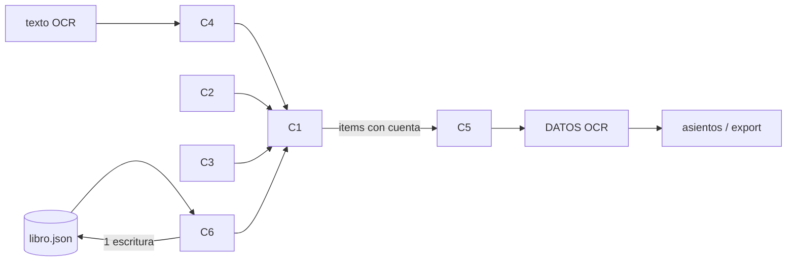

# 03 · Design — M-27 cuenta PUC por origen e ítem (aprobado, 2026-10-25)

## Summary
- **Forma:** la cuenta pasa del papel a sus **ítems**. `datos_ocr` emite **una fila de DATOS OCR por (papel, cuenta)**, y como los asientos ya salen por SUMIFS sobre DATOS OCR (ADR-002, DEBT-1), la caja menor no cambia y la factura pasa de 1 débito a N débitos + 1 crédito (ADR-019). El export trae un renglón por cuenta sin cambiar de formato (R8).
- **Motor:** `clasificar.py` se vuelve un motor puro por capas: origen → enseñado → frases/léxico a mano → léxico y proveedores minados → vecino (índice de trigramas + difflib) → puente. Lo minado es un JSON versionado sin valores, fechas ni nombres de personas, generado por un script desde el Excel manual (ADR-020).
- **Correcciones:** cada ítem lleva `manual`. Para reclasificar un mes hay dos pasos: plan (vista previa con huella) y aplicar (una escritura atómica del libro). Lo manual nunca cambia, y repetir no cambia nada (ADR-021).
- **Contador:** las 8 decisiones y los alias manual→PUC (R4) viven en `por_confirmar.json`. La validación PUC está dentro del motor (ADR-022).
- Hallazgo: el libro guardado **no conserva `items`** (0 en sept., ni en ventas), pero sí el `texto`. La reclasificación vuelve a sacar los ítems del texto guardado.

## 1 · Clarify
- Lo que mueve la arquitectura: R3 reparto (asiento y export), R5 capas + minado (N2 sin deps, N5 privacidad), R7 reclasificar sin pisar lo manual (N4), R4 validación PUC (regulated), N1 ≥ 85 % y N3 < 30 s por mes.
- No mueven la arquitectura: R1 (el origen ya decide en `datos_ocr` para venta, Rappi, cierre y extracto; solo se rotula el motivo), R6 (se amplía `aprender`), R9 y R10 (scripts aparte), R2 (parser).

## 2 · Estimates
- Un usuario y un PC. Sept.: 642 ventas, 141 gastos de caja, 96 facturas y 138 hojas de cierre en 30 días, unos 34 papeles al día. Los ítems por clasificar (factura y gasto) son unos 240 papeles × ~3, o sea **≈ 700–1.000 ítems al mes**. Las comandas no pasan por el motor (las decide el origen).
- Escrituras: un día cada vez (hoy) y una por mes al reclasificar. El libro pesa 1,7 MB por mes y crece unos 20 MB al año. Sigue siendo un archivo JSON.
- Corpus del vecino: ~1.537 filas del manual, que crecen ~300 al mes.
- **Presupuesto p99:** clasificar 1 ítem ≤ 5 ms (un día de unos 100 ítems ≤ 0,5 s, por debajo de N3). Reclasificar 1 mes ≤ 15 s (1.000 ítems × 5 ms + 30 × `construir` + 1 escritura), con margen frente a N3 (30 s).
- **Cuello de botella:** el vecino. Con difflib contra 1.500 filas por ítem serían unos 150 s al mes. Con índice de trigramas (top-20 candidatos) y luego `SequenceMatcher` solo sobre esos, queda en ~1 ms por ítem.
- **Más allá de la capacidad:** se reclasifica un mes por llamada, y el vecino corta en 20 candidatos. Si se pasa del presupuesto, el ítem va a la puente con el motivo «sin parecido a tiempo», que es mejor que dejarlo colgado.

## 3 · Components
| # | Componente | Qué posee |
|---|---|---|
| C1 | `contable/clasificar.py` · `Motor` | Capas, umbrales y motivo. Es puro: no lee el libro ni Flask. |
| C2 | `contable/modelo_manual.json` (versionado) + `herramientas/minar_manual.py` | Léxico minado {palabra: [cuenta, veces, total]}, proveedores {norm: [cuenta, n]}, vecinos [[texto_norm, cuenta, "julio fila 631"]] |
| C3 | `contable/por_confirmar.json` | Alias manual→PUC, las 8 decisiones (regla de mayoría, estado, fuente) y las cuentas puente (lee `contable.json` si existe). |
| C4 | `contable/documentos.py` · `items_de(doc)` | Saca los ítems de factura y vale (tabla o «nombre … valor»). Sin ítems, devuelve un solo ítem (detalle + proveedor). Los `gastos_detalle` del cierre son solo de referencia. |
| C5 | `contable/asientos.py` · `datos_ocr` + bloque 4 | Una fila por (papel, cuenta), la fila «diferencia ítems vs total» a la puente, y N débitos + 1 crédito por factura. |
| C6 | `contable/reclasificar.py` | `plan(lib, mes)` → cambios + huella · `aplicar(lib, plan)` → libro nuevo. No pisa ítems `manual`. |
| C7 | `app.py` + `static/contable.html` | Endpoints, cuenta por ítem en la tarjeta del papel, botón «Reclasificar mes» con vista previa. |
| C8 | `herramientas/medir_clasificacion.py` (R9) · `herramientas/por_confirmar_pdf.py` (R10) | Informe de acierto jun–ago → sept–oct y lista para el contador. |

## Data
- **Ítem** (en `documento.items[]`, opcional para lectores viejos): `{nombre, cant, valor, cuenta, conf, capa, motivo, manual}`. `capa` es una de: origen, enseñado, frase, lexico, minado, proveedor, vecino, puente, diferencia.
- **Documento:** `cuenta` se queda (expand→contract) y vale la cuenta del ítem de mayor valor, para la interfaz y el código viejo. Al leer un papel sin `items[].cuenta`, sale un ítem único con `cuenta` y `manual = cuenta_manual` (migración al leer, como `estado_de`).
- **Libro:** `reclasificaciones: [{mes, fecha_hora, cambios, version}]` sirve de rastro (R7, regulated). Antes de la primera escritura se guarda el respaldo `libro.antes-v1.8.0.json` (VERSION_RESPALDO).
- **Dinero:** pesos enteros. La diferencia ítems vs total = `valor − Σ items.valor`, y si `|dif| > 1` va a la puente.

## Interfaces
- `Motor(modelo, confirmar, aprendido).clasificar_item(origen, nombre, tercero="", texto="") -> {cuenta, conf, capa, motivo}`
- `Motor.clasificar_doc(doc) -> doc` llena `items[].cuenta` de los que no son `manual` y fija `doc.cuenta`. Es idempotente.
- `Motor.aprender(cuenta, nombre, tercero, todos_iguales: bool)`: guarda el proveedor solo si todos los ítems del papel van a la misma cuenta.
- `puc_valida(cuenta) -> (cuenta_final, motivo)`: aplica el alias de C3 y `puc.revisar`. Una cuenta que no sea «ok» ni «propia» va a la puente.
- `reclasificar.plan(lib, "2026-09", motor) -> {cambios:[{fecha, doc_id, numero, item, antes, despues, motivo}], huella}` · `aplicar(lib, plan, motor) -> lib`. Falla si la huella ya no coincide.
- `POST /api/contable/reclasificar {mes, aplicar?: huella}` · `POST /api/contable/aprender {cuenta, tercero, detalle, item?}` (se amplía).

## Threat model (light: exposed no, 127.0.0.1)
- Fronteras: texto OCR → parser (no confiable), Excel manual → `modelo_manual.json` (privacidad), libro.json ↔ app (integridad).
- S: no aplica (un usuario local). T: la vista previa y lo aplicado deben ser lo mismo → **S1** huella del plan (C6). Lo manual no se pisa → **S2** C1/C6 saltan `manual`.
- R: **S3** `reclasificaciones[]` en el libro + respaldo por versión. I: **S4** el modelo minado sin valores, fechas ni nombres de personas (N5): solo tokens que salen ≥ 2 veces en el manual y que no están en la lista de terceros persona.
- D: el reclasificado está acotado a un mes y el vecino a 20 candidatos (§2). E: no aplica. La regla se cumple en C1/C6 (dominio), no en la interfaz.

## Valores de fuera (regulated)
- Los códigos de 6 dígitos se validan en `puc.revisar` (Decreto 2650/1993, arts. 6–7, `puc_cuentas.json`). Las auxiliares de 8 dígitos y las puentes son del contador (`por_confirmar.json`, `contable.json`). Las 8 decisiones (fuente «contador, pendiente») quedan en `por_confirmar.json` con `estado: por confirmar | confirmado`. Los umbrales (≥ 2, ≥ 80 %, conf. mínima 0,75) son internos y van en `por_confirmar.json["umbrales"]` con su default documentado. La validación vive en `puc_valida` (C1), no en el formulario.

## R/S → component
| Req | Dueño | Req | Dueño |
|---|---|---|---|
| R1 origen | C1 capa origen (+ `datos_ocr` ya existente) | R7 reclasificar | C6 + C7 (S1, S2, S3) |
| R2 ítems | C4 | R8 export | C5 (sin cambiar `exportar.py`) |
| R3 reparto | C5 | R9 acierto | C8 + C2 (minado jun–ago) |
| R4 PUC | C1 `puc_valida` + C3 | R10 por confirmar | C3 + C8 |
| R5 capas | C1 + C2 | N1/N3 | C1 vecino con índice, C8 mide |
| R6 enseñar | C1 `aprender` + C7 | N5/S4 | C2 `minar_manual.py` + fitness ADR-020 |

## Risks
1. **N1 no llega al 85 %** (el manual es inconsistente, R4/R5 de 01). Mitigación: medir en el primer task (C2 + C8) antes de tocar la interfaz. Si sale por debajo, plan B sklearn en un ADR nuevo.
2. **Los ítems de factura no se leen bien** (el OCR da tablas irregulares). Hay que hacer un spike (XS, 1 h) con las 96 facturas de sept.: ¿cuántas dan ≥ 1 ítem con valor, y cuántas suman el total ±1 %? Si son < 50 %, la factura se queda con un ítem único y solo se reparten las que sí cuadran.
3. **El reparto cambia el balance de sept.**, que ya se mandó al contador. Mitigación: `plan` muestra el antes→después por cuenta, el fitness test de R8 comprueba que con papeles de una sola cuenta el balance da igual, y se le avisa al contador (pendiente en STATE).
- **Sacrificado:** ni sklearn ni rapidfuzz (menor tolerancia a palabras nuevas), libro en JSON en vez de SQLite, y no hay inventario por ítem.
- **A 10×** (10 locales o 10 años): el libro pasa a SQLite (por día) y el vecino a TF-IDF (plan B). Las capas y las interfaces no cambian.
