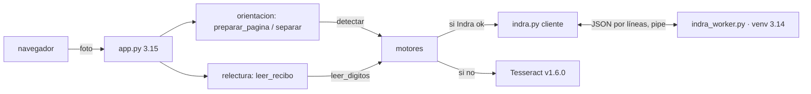

# 03 · Diseño — M-25 Indra OCR  (aprobado 2026-10-20)

## Summary
- **Un trabajador Indra persistente** (venv 3.14, `-I`) que habla JSON por líneas; lo arranca la app en el primer uso, con candado, tiempos límite, un reinicio y luego «Indra caído por esta sesión» (ADR-016).
- **Una fachada `ocr_module/motores.py`** elige motor: Indra si está, si no Tesseract como en v1.6.0. Expone `leer_digitos` y `detectar_giro` con las firmas de hoy, así `relectura` y `validar` no cambian (ADR-017).
- **Enderezado:** el trabajador devuelve solo `{giro, inclinación}`; la app gira con PIL. Hoja derecha (giro 0, |incl.| < 0,3°) → la imagen no se toca, sin regresión en 0° (ADR-018).
- **Instalador** `instalar_indra.bat` + `indra_requisitos.txt` (todas las versiones fijadas). Crea `indra_venv\` en la carpeta de la app y los modelos en `indra_venv\modelos`. Es idempotente y termina en «Indra listo».
- Sin datos nuevos guardados. El motor R3 usado sale en `/api/contable/capacidades` y en el aviso de la interfaz.

## 1 · Qué guía la arquitectura
- **Guían:** R1 (lector R3), R2 (enderezado), R4 (respaldo + aviso), N3 (sin red), N4 (candado), N6 (3.15 ↔ 3.14 → proceso aparte).
- **Pesan poco:** R3 (se mide en 6-test), R5 (EOF + arranque perezoso, sale casi gratis), R6 (script), R7/R8 (prueba y lectura), N1/N2 (el spike ya los cumple), N5 (ONNX en CPU es determinista).

## 2 · Estimación
- Usuarios: 1–2 PC, un navegador que manda una foto por vez. ≈ 300 hojas/mes, picos de ≈ 30 hojas en una tarde.
- Pedidos al trabajador por hoja: 1 enderezado + ≈ 4 recortes × (1 + relecturas ≈ 1,2) ≈ 6 pedidos → < 1 pedido/s en el pico.
- Presupuesto p99 por hoja (sin qwen): enderezado ≤ 0,5 s + R3 6 × 0,2 s ≈ 1,7 s. El costo dominante sigue siendo qwen (segundos por recorte); Indra es < 10 % del tiempo de la hoja.
- Holgura: el trabajador está ocupado < 10 % del tiempo de una hoja (muy por debajo de 60–70 %).
- Más carga de la que cabe: un pedido espera el candado como máximo el tiempo límite; si vence, esa llamada usa Tesseract (degradar, nunca encolar sin tope).
- Almacenamiento: 0 por año. Una vez: ≈ 76 MB de modelos + ≈ 400 MB del venv por PC.

## 3 · Componentes
| # | Componente | Dueño de |
|---|---|---|
| C1 | `ocr_module/indra_worker.py` (corre en el venv 3.14) | Carga `OrtOCR` una vez, saluda `ready` y atiende `numeros` (texto de las líneas) y `upright` (giro + inclinación). Sale con `quit` o con EOF en stdin |
| C2 | `ocr_module/indra.py` (cliente, en la app) | Proceso: arranque perezoso, candado, tiempos límite, matar/reiniciar, interruptor de fallas, stderr a `logs/indra.log`, `atexit`, `CREATE_NO_WINDOW` |
| C3 | `ocr_module/motores.py` (fachada) | Elige Indra o Tesseract por llamada y lleva el estado para la interfaz |
| C4 | `orientacion.py` (cambio chico) | `preparar_pagina` y `separar/_recortes` reciben `detectar=` (por defecto, el de Tesseract) y aplican el giro y la inclinación |
| C5 | `app.py` + interfaz | Conecta `motores`; `capacidades` agrega `motor` y `aviso`; la interfaz muestra el aviso |
| C6 | `instalar_indra.bat` + `indra_requisitos.txt` | venv, dependencias fijadas, descarga única de modelos, prueba de humo |
| C7 | `probar_indra.py` (R7) + `probar_motores.py` | Trabajador real (si está instalado), y respaldo con un trabajador falso que se cuelga o muere |

## 4 · Datos
- No hay tablas nuevas ni migraciones. Las fotos viajan en base64 por la tubería y no se escriben a disco.
- Estado en memoria (C2/C3): `motor ∈ {indra, tesseract}`, `motivo` (sin venv · falló el arranque · caído tras 2 fallas), `fallas_seguidas`.
- Config por variables de entorno con valores por defecto: `INDRA_VENV` (= `<app>\indra_venv`), `INDRA_OCR_MODEL_DIR` (= `<venv>\modelos`), `INDRA_TIMEOUT_S` (= 10), `INDRA_ARRANQUE_S` (= 30), `INDRA_HILOS` (= 4). El trabajador corre siempre con `HF_HUB_OFFLINE=1` y `HF_HUB_DISABLE_TELEMETRY=1`.

## 5 · Interfaces (firmas)
- Pipe C2→C1: `{"op":"numeros","png":b64}` → `{"texto":str,"ms":float}` · `{"op":"upright","png":b64}` → `{"giro":0|90|180|270,"incl":float,"ms":float}` · `{"op":"quit"}`. Cualquier error → `{"error":str}`. El saludo es `{"ready":true,"version":"1.1.2","load_s":float}`.
- `indra.Cliente.pedir(op, img, timeout) -> dict` y lanza `IndraNoDisponible` · `indra.disponible() -> bool` (comprueba que existe `python.exe` del venv; no arranca nada).
- `motores.leer_digitos(img) -> set | None`: Indra → `digitos._enteros(texto)`; si no, `numeros_tesseract(img)`.
- `motores.detectar_giro(img) -> (grados_horario, confianza, inclinacion)`: Indra → `(giro, 1.0, incl)`; Tesseract → `(g, conf, 0.0)`.
- `motores.estado() -> {"motor", "aviso"}` · `orientacion.preparar_pagina(data, giro="auto", detectar=None)` · `separar(img, …, detectar=None)`.
- Giro de Indra a grados horarios: `k=4 → 270`, si no `90·k`. La inclinación usa el mismo signo que `cv2.getRotationMatrix2D` y que `PIL.rotate` (antihorario +).

## 6 · Modelo de amenazas (ligero, `exposed: no`)
Fronteras: app ↔ trabajador (tubería local, mismo usuario) e instalador ↔ PyPI/Hugging Face (una vez).
- **S** El venv podría cambiarse por otro: la ruta sale de config del dueño, no del pedido; `-I` evita importar del cwd → R4.
- **T** Salida del trabajador alterada o rota: se parsea solo JSON, se validan tipos y rangos (giro ∈ {0,90,180,270}, |incl| ≤ 45), y si no cuadra cuenta como falla → Tesseract (R4).
- **T (cadena de suministro)** `indra_requisitos.txt` con todas las versiones fijadas (sale de `pip freeze` del venv del spike), `indra-ocr==1.1.2` → R6, R7.
- **R** Cada falla, reinicio y cambio de motor va a `logs/indra.log` con la hora.
- **I** Sin red después de instalar (`HF_HUB_OFFLINE=1`; 6-test lo comprueba con la red cortada). Las fotos no tocan disco → N3.
- **D** Un trabajador colgado: tiempo límite, matar, reiniciar una vez y luego apagarlo por la sesión; el candado tiene tope → R4, N4.
- **E** El trabajador corre con el mismo usuario y sin shell (`Popen` con lista, `shell=False`) → R6.

## 7 · Mapa R/N → componente
R1 → C1 `numeros` + C3 `leer_digitos` · R2 → C1 `upright` + C4 · R3 → sin código nuevo, se mide en 6-test con `medir_precision` · R4 → C2 interruptor + C3 + C5 aviso · R5 → C1 EOF + C2 perezoso/`atexit` · R6 → C6 · R7 → C7 `probar_indra.py` · R8 → runbook 07 · N1/N2 → C1 hilos = 4, un solo proceso · N3 → C2 env + C6 · N4 → C2 candado · N5 → C7 (dos lecturas iguales) · N6 → C7 + `probar_*` de siempre. Todos los Must tienen dueño.

## 8 · Riesgos
1. **Indra se equivoca de giro en una hoja que Tesseract tenía bien.** `upright()` no da confianza y la tratamos como 1,0. Mitigación: R2 con las 20 hojas × 4 giros en 6-test. Si falla alguna, se usa el giro de Tesseract cuando su confianza es ≥ 0,8 y contradice a Indra (cambio de una línea en C3).
2. **Enderezar con `expand` y fondo blanco no es lo mismo que en el spike** (allá: `BORDER_REPLICATE` sin `expand`). Mitigación: spike XS al empezar 5-implement con 3 hojas a 8°/25°/45° → inclinación final ≤ 1° y los mismos recortes. Si no, se copia el método del spike.
3. **`upright()` no documentado / repo de un solo mantenedor.** Mitigación: versiones fijadas, `probar_indra.py` falla con «ADR-018» si cambia la salida, y el respaldo a Tesseract.
- **Lo que se sacrifica:** sin GPU, sin varios trabajadores, sin limpiar fotos con perspectiva; Tesseract queda instalado solo como respaldo.
- **A 10× (≈ 3 000 hojas/mes):** sigue cabiendo (el trabajador ocupado < 30 %); el cuello de botella sería qwen, no Indra. A 100× tocaría un grupo de 2 trabajadores (+440 MB cada uno).
